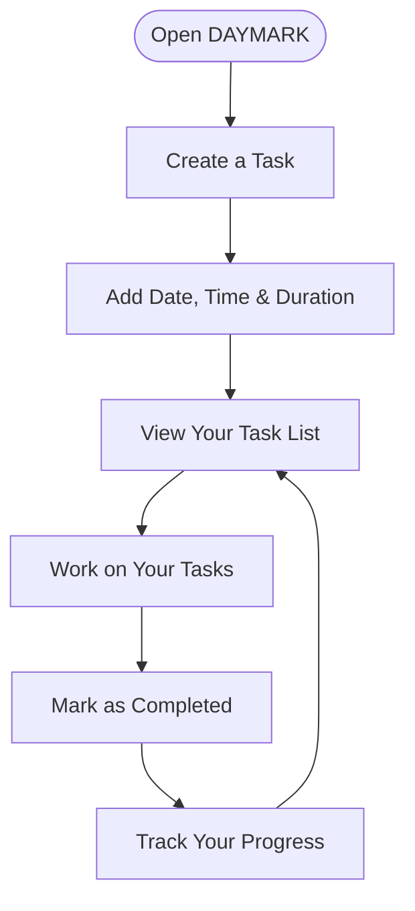

# DAYMARK
### Make time count. One task at a time.

<p align="center">
  <strong>A clean, thoughtfully designed space to organise your day, manage your commitments, and keep moving forward.</strong>
</p>

<p align="center">
  
  
  
  
</p>

<p align="center">
  <a href="https://daymark.vercel.app/">🚀 Live Demo — Explore DAYMARK</a>
</p>

---

## ✦ Overview

DAYMARK is a Django-powered task management web application designed to make everyday planning simpler and more organised.

It provides a structured way to create tasks, assign dates and times, estimate durations, and track completion—all through a clean and minimal interface.

Rather than overwhelming users with unnecessary complexity, DAYMARK focuses on what matters: **knowing what needs to be done and making steady progress towards completing it.**

## ✦ Features

| Feature | Description |
|---|---|
| **Task Management** | Create, organise, update, and delete tasks. |
| **Task Scheduling** | Assign specific dates and times to your commitments. |
| **Duration Tracking** | Set an estimated duration for individual tasks. |
| **Completion Tracking** | Mark tasks as completed and monitor your progress. |
| **Progress Overview** | View your total, completed, and ongoing tasks. |
| **Clean Interface** | A minimal, thoughtfully styled interface designed for everyday use. |
| **Persistent Storage** | Store task information using a database. |

## ✦ The Experience

DAYMARK follows a simple workflow:



The idea is straightforward: organise your commitments, focus on execution, and keep your progress visible.

## ✦ Technology Stack

| Technology | Purpose |
|---|---|
| Python | Core programming language |
| Django | Backend framework and application logic |
| HTML | Web page structure |
| CSS | Interface styling and visual presentation |
| JavaScript | Client-side interactions |
| PostgreSQL | Production database |
| SQLite | Local development database fallback |
| Vercel | Application deployment |

## ✦ Project Structure

```text
DAYMARK/
│
├── api/
│   └── index.py
│
├── config/
│   ├── settings.py
│   ├── urls.py
│   └── wsgi.py
│
├── tasks/
│   ├── migrations/
│   ├── models.py
│   ├── views.py
│   └── ...
│
├── static/
│   └── tasks/
│       └── style.css
│
├── templates/
│
├── manage.py
├── requirements.txt
├── vercel.json
└── README.md
```

## ✦ Getting Started

Follow these steps to run DAYMARK on your local machine.

### Prerequisites

- Python 3.11 or later
- Git
- pip

### 1. Clone the Repository

```bash
git clone https://github.com/Multifarious-Panoply/DAYMARK.git
cd DAYMARK
```

### 2. Create a Virtual Environment

```bash
python -m venv .venv
```

Activate it:

**macOS / Linux**
```bash
source .venv/bin/activate
```

**Windows**
```bash
.venv\Scripts\activate
```

### 3. Install Dependencies

```bash
pip install -r requirements.txt
```

### 4. Configure the Database

By default, the application can use its local SQLite database.

For PostgreSQL, configure the `DATABASE_URL_UNPOOLED` environment variable with your own database connection string.

Do not commit database credentials or secret keys to the repository.

### 5. Apply Database Migrations

```bash
python manage.py migrate
```

### 6. Start the Development Server

```bash
DEBUG=True python manage.py runserver
```

### 7. Open DAYMARK

Visit:

```text
http://127.0.0.1:8000/
```

You can now explore the application locally.

## ✦ Deployment

DAYMARK is deployed using **Vercel**, with PostgreSQL provided through Neon.

The production setup separates application hosting from database storage, allowing the application to run online while maintaining persistent task data.

## ✦ Project Motivation

DAYMARK was developed around a simple observation: managing everyday responsibilities should not feel more complicated than completing them.

The project explores how a straightforward task-management experience can combine practical scheduling, progress visibility, and a clean interface.

It also serves as a hands-on exploration of Django development, database integration, frontend styling, and cloud deployment.

## ✦ Future Scope

Potential areas for further development include:

- User authentication and personalised task spaces.
- Calendar-based task organisation.
- Reminders and notifications.
- Productivity insights and activity summaries.
- Improved mobile experience.

## ✦ Contributing

Suggestions, bug reports, and improvements are welcome.

If you would like to contribute:

1. Fork the repository.
2. Create a new feature branch.
3. Make your changes.
4. Submit a pull request.

## ✦ Acknowledgements

Built with curiosity, persistence, and a belief that small, consistent actions make a meaningful difference.

---

<p align="center">
  <strong>DAYMARK</strong><br>
  <em>Make time count.</em>
</p>
